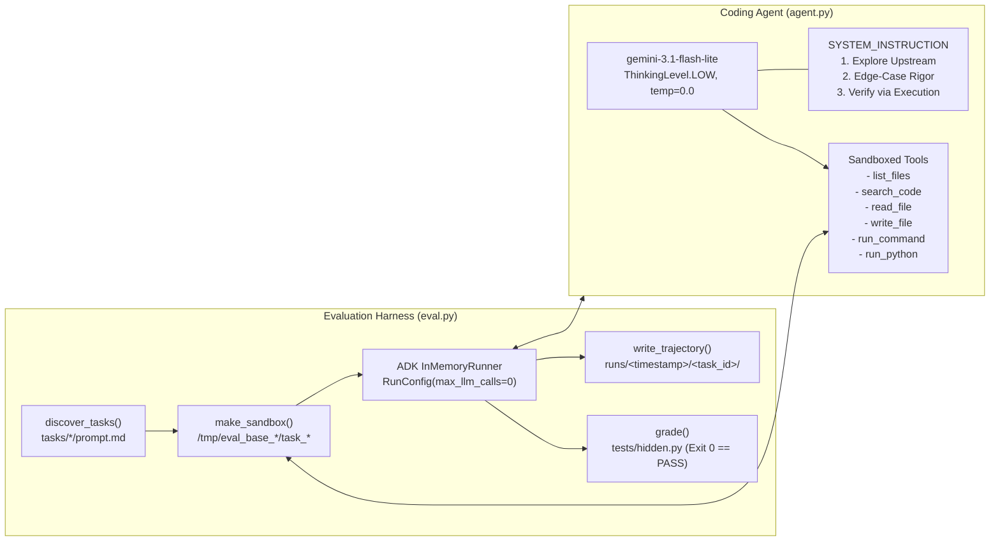

# [FDE] Coding Agent Hill Climbing: Challenge Lab (L400-APEX007)

A complete reference repository, conceptual deep dive, and step-by-step execution manual for the **Coding Agent Hill Climbing Challenge Lab (`L400-APEX007`)**.

---

## 1. Executive Summary & Core Philosophy

In production AI engineering, you often cannot simply "swap in a larger, more expensive model" to improve reliability—due to latency SLAs, token cost budgets, or deployment constraints. In this lab, **Cymbal Software** uses **`gemini-3.1-flash-lite`** with a **`LOW` thinking budget** to keep inference fast and inexpensive.

With the model and thinking budget strictly locked, **every capability gain must come from the agent's harness**:
1. **Tools** — How the agent perceives the workspace (`list_files`, `search_code`, `read_file`), modifies files (`write_file`), and verifies its work (`run_command`, `run_python`).
2. **System Instructions (`SYSTEM_INSTRUCTION`)** — How the agent is steered to explore upstream root causes before editing, handle boundary conditions and strict output contracts, and run a verification loop before finishing.
3. **Runtime Configuration** — Deterministic decoding (`temperature=0.0` instead of `1.0`) and resilient API retry behavior (`HttpRetryOptions`).

| Metric | Baseline Agent (`agent_baseline.py`) | Optimized Agent (`agent.py`) |
|---|---|---|
| **Model** | `gemini-3.1-flash-lite` (`ThinkingLevel.LOW`) | `gemini-3.1-flash-lite` (`ThinkingLevel.LOW`) |
| **Temperature** | `1.0` (high variance / flaky) | `0.0` (deterministic) |
| **Available Tools** | 2 (`read_file`, `write_file`) | 6 (`list_files`, `search_code`, `read_file`, `write_file`, `run_command`, `run_python`) |
| **System Prompt** | 1-sentence generic instruction | Structured 3-phase engineering workflow (Explore -> Implement with Rigor -> Verify) |
| **Eval Pass Rate** | **1–2 / 5** (20–40%, flaky) | **5 / 5** (100% pass rate) |
| **LLM Judge Score (`/grade-my-agent`)** | **0 / 100** (`fail`) | **100 / 100** (`pass`) |

---

## 2. System Architecture & Evaluation Harness



### Repository Layout

| Path | Role | Editable in Lab? |
|---|---|---|
| [`agent.py`](./agent.py) | **Optimized coding agent** (`build_agent(sandbox, model)`) with 6 sandboxed tools and a 3-stage system prompt. | **Yes** (Only file edited) |
| [`agent_baseline.py`](./agent_baseline.py) | **Original baseline coding agent** (104 lines, only `read_file` and `write_file`, 1-line prompt, `temperature=1.0`). | Reference copy |
| [`eval.py`](./eval.py) | **Evaluation harness**: discovers tasks under `tasks/`, creates isolated temporary sandboxes, runs `build_agent` in parallel via `asyncio`, harvests ADK trajectories, and runs `tests/hidden.py`. | No |
| [`tasks/`](./tasks/) | The 5 benchmark tasks (2 bug-fix tasks with `src/`, 3 build-from-scratch CLI tasks without `src/`). | No |
| [`.agents/skills/submit-task-diagnosis/SKILL.md`](./.agents/skills/submit-task-diagnosis/SKILL.md) | Skill used in **Task 3** (`/submit-task-diagnosis`) to grade your root-cause diagnosis of why the baseline agent failed. | No |
| [`.agents/skills/grade-my-agent/SKILL.md`](./.agents/skills/grade-my-agent/SKILL.md) | Skill used in **Task 5** (`/grade-my-agent`) to grade `agent.py` against a 100-point LLM-as-judge rubric. | No |
| [`task_diagnosis_submission.json`](./task_diagnosis_submission.json) | Graded output artifact from `/submit-task-diagnosis` (100/100). | Generated |
| [`judge_model.json`](./judge_model.json) | Graded output artifact from `/grade-my-agent` (100/100). | Generated |

### How `eval.py` Works Under the Hood
1. **Task Discovery (`discover_tasks`)**: Scans `tasks/<task_id>/prompt.md`.
2. **Sandbox Isolation (`make_sandbox`)**:
   - Creates a temporary directory `/tmp/eval_base_.../task_...`.
   - If `tasks/<task_id>/src/` exists (**bug-fix task**), copies `src/` into the sandbox.
   - If `tasks/<task_id>/src/` does not exist (**build task**), creates an empty `src/` directory in the sandbox.
   - **Crucially, `tests/hidden.py` is NOT copied into the sandbox while the agent runs**, so the agent cannot see the grading tests.
3. **Path Jail (`_resolve(sandbox, path)`)**:
   - Every tool resolves paths via `os.path.realpath(os.path.join(sandbox, path))` and verifies `full.startswith(sandbox + os.sep)`, preventing `../` directory traversal outside the sandbox.
4. **ADK Execution (`run_task`)**:
   - Instantiates `InMemoryRunner(agent=build_agent(sandbox, model))` with `RunConfig(max_llm_calls=0)` (no LLM turn cap).
   - Feeds `prompt.md` as a single user message and streams events until the agent finishes.
5. **Trajectory Harvesting (`write_trajectory`)**:
   - Converts raw ADK session events into ADK `EvalSet` invocations (`EvaluationGenerator.convert_events_to_eval_invocations(events)`) and writes four debugging artifacts to `runs/<timestamp>/<task_id>/`:
     - `trajectory.evalset.json`: Full ADK trajectory (all model thoughts, text replies, tool calls, and tool responses).
     - `tool_uses.json`: Flattened, skimmable list of `tool_uses` and `tool_responses`.
     - `src/`: Snapshot of the final code shipped by the agent before the temp sandbox is deleted.
     - `repro.sh`: Standalone bash script that copies the shipped `src/` and `tasks/<task_id>/tests/hidden.py` into a throwaway folder and runs the hidden test so you can see the exact traceback.
     - `run.json`: Metadata (`passed`, `tool_calls`, `seconds`, `stop_reason`).
6. **Out-of-Band Grading (`grade`)**:
   - Overwrites `<sandbox>/tests/` with `tasks/<task_id>/tests/` and runs `python tests/hidden.py` with a 30-second timeout. Exit code `0` = `PASS`.

---

## 3. Deep Dive: The 5 Evaluation Tasks, Hidden Traps & Baseline Failures

A central lesson of this lab is distinguishing between:
- **The Task Bug / Spec Trap** (what is wrong in the code or tricky in the specification), and
- **The Agent Capability Gap** (why the coding agent failed to find, fix, or verify it).

### Summary of All 5 Tasks

| Task ID | Type | Prompt Summary | Hidden Trap / Bug | Why the Baseline Agent Failed (Agent Capability Gap) |
|---|---|---|---|---|
| **`invoice_report`** | Bug Fix (`src/` provided) | `invoice_total(amounts)` in `src/invoices/report.py` totals `$19.99` and `$5.50` as `$24.00` instead of `$25.49`. Fix the root cause. | `src/invoices/report.py` (`return round(sum(amounts), 2)`) is **already correct**! The real bug is upstream in `src/invoices/load.py`, where `parse_amount(raw)` does `return int(float(raw))`, truncating cents before `invoice_total` is ever called. Also, `tests/hidden.py` asserts `invoice_total(amounts) == 125.49` (a Python `float`), so changing the return type to `Decimal` fails `==`! | **1. No file discovery / search + Over-trust of prompt**: Only read/edited `report.py` named in the prompt; never knew `load.py` existed.<br/>**2. No execution tool**: Wrote `reproduce_bug.py` and `run_repro.py` scripts it had no tool to run, so it never saw its edit left the total at `124.0`. |
| **`reminder_time`** | Bug Fix (`src/` provided) | Event at `"2026-03-10T09:00:00-05:00"` should be `14` UTC, but `reminder_hour_utc` in `src/scheduling/core.py` reports `9`. | `src/scheduling/core.py` is **already correct**! The real bug is upstream in `src/scheduling/parsing.py`, where `parse_event` calls `.replace(tzinfo=None)` on parsed ISO timestamps, stripping the `-05:00` offset and turning it into a naive datetime that `core.py` assumes is UTC. | **1. Anchored on prompt-named file (`core.py`)**: Lacked `list_files` / `search_code` to discover `src/scheduling/parsing.py`.<br/>**2. No execution tool**: Wrote throwaway scripts (`repro.py`, `list_root.py`, `list_tests.py`) via `write_file` hoping they would run, then blindly edited `core.py`. |
| **`range_list`** | Build CLI (`src/expand.py`) | Read comma-separated integers or ranges `a-b` from stdin and print expanded integers space-separated (`1-3,5,7-9` -> `1 2 3 5 7 8 9`). | **Unstated edge case**: `tests/hidden.py` passes a **descending range** `9-7` and expects `9 8 7\n`, plus negative ranges (`-2-1` -> `-2 -1 0 1`). Naive `range(start, end + 1)` returns `[]` when `start > end`, and naive `item.split('-')` breaks on negative numbers like `-2-1`. | **One-shot without verification or boundary analysis**: Wrote `range(start, end + 1)` from the ascending examples in the prompt and had no execution tool or prompt requirement to test reversed/negative ranges. |
| **`interval_set`** | Build CLI (`src/intervals.py`) | Read decimal intervals `start end` from stdin; support `merge`, `count`, `length`, `covers X`. Exit `2` on stderr for errors. | **Multiple strict contract traps**:<br/>1. `length` on **empty input** must print `0.00` (`sum(gen)` returns `int 0`, which crashes with `AttributeError` on `.quantize()`).<br/>2. Half-up rounding (`3.675` -> `3.68`, requiring `ROUND_HALF_UP`, not Python's default round-half-to-even).<br/>3. Trailing-zero trimming in `merge` (`4.0` -> `4`, `10.0` -> `10`; `Decimal.normalize()` turns `10.0` into `1E+1`!).<br/>4. Touching intervals (`1 3` and `3 5` -> `1 5`). | **No execution / self-test loop**: One-shotted `src/intervals.py` without testing empty stdin on `length`, rounding ties, or exit code `2` on stderr. |
| **`expense_report`** | Build CLI (`src/ledger.py`) | Read `date,category,amount` from stdin; support `total`, `count`, `average`, `categories`, `top N`, `category NAME`. | **Multiple strict contract traps**:<br/>1. Half-up rounding (`5.005` -> `5.01` via `ROUND_HALF_UP`).<br/>2. Empty stdin on `total` and `average` must print `0.00` (`sum()` `int 0` `.quantize()` crash or `ZeroDivisionError`).<br/>3. Exit code `1` (stderr) when `category NAME` is not found vs. exit code `2` (stderr) for malformed lines or invalid commands.<br/>4. Tie-breaking in `categories`: amount descending, then name ascending (`(-amt, name)`). | **Mode A**: Crashed on empty input (`total`/`average`) due to no execution tool to test edge cases.<br/>**Mode B**: At `temperature=1.0` with a weak 1-line prompt, sometimes printed code in chat without calling `write_file` (0 tool calls). |

---

## 4. Harness Optimization Breakdown (`agent_baseline.py` vs `agent.py`)

### 4.1 Tooling Upgrades
The baseline agent only had `read_file` and `write_file`. When it wanted to inspect the directory or run a test, it literally used `write_file` to create `list_root.py` or `run_repro.py`—which sat inert on disk because nothing executed them!

In [`agent.py`](./agent.py), we equip the agent with **6 sandboxed tools**:

1. **`list_files(directory: str = ".") -> dict`**:
   Walks the sandbox recursively (ignoring `__pycache__`, `.git`, `.venv`, `.pyc`) and returns all relative file paths. This immediately reveals sibling modules like `src/invoices/load.py` and `src/scheduling/parsing.py`.
2. **`search_code(pattern: str, directory: str = ".") -> dict`**:
   Runs regex search across all files in the sandbox, returning `path:lineno: line` matches so the agent can trace callers and imports across a package.
3. **`read_file(path: str) -> dict`**:
   Reads a sandbox-relative file safely.
4. **`write_file(path: str, contents: str) -> dict`**:
   Creates or overwrites a sandbox-relative file safely.
5. **`run_command(command: str, stdin_data: str = "") -> dict`**:
   Executes a shell/CLI command inside the sandbox working directory with `PYTHONPATH` set to `sandbox:sandbox/src`, piping `stdin_data` to standard input, and returns `{"returncode": ..., "stdout": ..., "stderr": ...}` (with a 15s timeout). Essential for testing CLI apps (`expand.py`, `intervals.py`, `ledger.py`) across valid, empty, and malformed inputs.
6. **`run_python(code: str, stdin_data: str = "") -> dict`**:
   Executes `python -c <code>` inside the sandbox with `stdin_data` and returns `returncode`, `stdout`, and `stderr`. Ideal for reproducing and verifying library bug-fix tasks (`invoice_report`, `reminder_time`) without leaving temporary files in `src/`.

### 4.2 System Instruction Engineering (`SYSTEM_INSTRUCTION`)

The optimized `SYSTEM_INSTRUCTION` in [`agent.py`](./agent.py) enforces a 3-step engineering discipline that directly addresses every failure mode while remaining 100% general (no hardcoded task names or answers):

```text
1. EXPLORE & TRACE ROOT CAUSES BEFORE EDITING (BUG-FIX TASKS):
   - Always start by calling `list_files` to inspect the workspace structure.
   - If existing source files are present in `src/`, NEVER assume the bug is in the single file or function named in the prompt.
   - Read ALL files in the package (including `__init__.py` and sibling helper modules such as parsing, loading, or data-ingestion helpers) using `read_file` or `search_code` before making any edits.
   - Trace the full data flow upstream from where raw inputs are parsed/loaded to where results are computed. Fix the true root cause in the upstream module rather than patching symptoms downstream.
   - CRITICAL FOR BUG-FIX TASKS: Make the minimal fix in the upstream helper only (e.g. removing an unwanted `int(...)` cast around `float(raw)` or removing `.replace(tzinfo=None)`), and leave the downstream module untouched. NEVER change return types from `float` to `Decimal` in existing library functions, because tests compare return values directly against `float` literals with `==` (and `Decimal('125.49') == 125.49` evaluates to `False` in Python).

2. IMPLEMENT WITH RIGOR ON EDGE CASES & OUTPUT CONTRACTS (BUILD-FROM-SCRATCH CLI TASKS):
   - Always use `write_file` to save your code to the required file path. Never just print code in your final response without calling `write_file`.
   - Enumerate and handle boundary conditions systematically:
     * Sequence & range direction: Support both ascending (`a <= b`) and descending/reversed ranges (e.g., `9-7` must expand in descending order `9 8 7` when `start > end`), single values, and `start == end`.
     * Numeric precision & money rounding (for CLI programs built from scratch): When building a standalone CLI script that formats money or decimal intervals to stdout, use `decimal.Decimal` initialized from strings (not `float`). For half-up rounding to two decimal places, use `.quantize(Decimal("0.01"), rounding=ROUND_HALF_UP)` (so `5.005` rounds to `5.01` and `3.675` rounds to `3.68`). Always pass a `Decimal("0")` start value to `sum(..., Decimal("0"))` so empty inputs return `Decimal("0")` instead of integer `0`.
     * Trailing-zero trimming: To format a `Decimal` with trailing zeros trimmed (e.g., `4.0` -> `4`, `1.50` -> `1.5`), use `format(val, "f")` and strip trailing `"0"` and `"."` only when `"."` is present (avoid `.normalize()`, which turns multiples of 10 like `10.0` into scientific notation `1E+1`).
     * Empty & blank inputs: Handle empty stdin and blank lines explicitly according to the specification (e.g., printing nothing on empty range input, or `0.00` for totals/averages/lengths on empty records).
     * Exact exit codes & stderr: For invalid commands, missing arguments, missing categories, or malformed input lines (wrong field count, unparseable numbers, or `start > end` where disallowed), print an error message to `sys.stderr` (never `stdout`) and exit with the exact required code (`sys.exit(2)` or `sys.exit(1)`).

3. VERIFY BY EXECUTING CODE & TESTS BEFORE FINISHING:
   - Never finish without executing and testing your code via `run_python` or `run_command`.
   - For bug fixes: first reproduce the failure across the full pipeline (calling upstream load/parse functions and passing their output to downstream functions), apply the minimal fix to the upstream root cause, and re-run to confirm `isinstance(result, float)` or `isinstance(result, int)` and exact `==` equality with the expected Python literal.
   - For CLI programs: use `run_command` with `stdin_data` to test every subcommand, every example in the prompt, and all edge cases (empty input, blank lines, descending ranges like `9-7`, touching intervals, half-up rounding ties like `.005` or `.675`, missing lookup keys, and malformed inputs verifying both `stderr` and `returncode`).
   - If any check fails, diagnose the error, update the file with `write_file`, and re-verify until all tests pass. Do not leave temporary test files inside `src/`.
```

---

## 5. Step-by-Step Running Manual

Follow these exact steps to run the lab from start to finish in Google Cloud Shell or any local Python 3.12+ environment with Vertex AI access.

### Task 1: Initialize the Environment and Set Up Antigravity CLI

1. **Authenticate Google Cloud CLI**:
   ```bash
   gcloud auth login
   ```
2. **Copy Lab Files from the Provisioned GCS Bucket** *(when running inside Qwiklabs)*:
   ```bash
   gcloud storage cp -r "gs://<YOUR_PROJECT_ID>-l400-apex/*" ~/.
   mkdir -p ~/.vscode && cp ~/settings.json ~/.vscode/
   ```
3. **Create and Activate the Python Virtual Environment (`.venv`)**:
   ```bash
   python3 -m venv .venv
   source .venv/bin/activate
   pip install -r requirements.txt
   ```
4. **Smoke-Test `agent.py` Standalone**:
   ```bash
   python agent.py "Write a hello world python script"
   ```
   This creates a script under `./out/` and executes it (`Hello, World!`).

---

### Task 2: Run the Baseline Evaluation (AT ID: 1)

1. **Run the Full Evaluation Harness**:
   *(If you want to test the original unoptimized agent first, copy `cp agent_baseline.py agent.py` before running)*:
   ```bash
   source .venv/bin/activate
   python eval.py
   ```
2. **Inspect the Output**:
   - The baseline agent typically solves only **1 or 2 out of 5 tasks** (`invoice_report`, `reminder_time`, and `range_list` consistently fail).
   - `eval.py` saves all per-task trajectories to `runs/<timestamp>/<task_id>/` and uploads `runs/<timestamp>/summary.json` to `gs://<PROJECT_ID>-l400-apex/summary.json`.
   - You can also evaluate a single task at any time with:
     ```bash
     python eval.py --task invoice_report
     ```

---

### Task 3: Analyze Agent Trajectories Manually & Submit Diagnosis (AT ID: 2)

1. **Run the Reproduction Script for a Failed Task**:
   ```bash
   bash runs/<timestamp>/invoice_report/repro.sh
   ```
   Output:
   ```text
   Traceback (most recent call last):
     File "/tmp/tmp.../tests/hidden.py", line 8, in <module>
       assert invoice_total(amounts) == 125.49, invoice_total(amounts)
              ^^^^^^^^^^^^^^^^^^^^^^^^^^^^^^^^
   AssertionError: 124.0
   hidden.py exit code: 1 (0 = PASS)
   ```
2. **Inspect the Trajectory (`tool_uses.json` / `trajectory.evalset.json`)**:
   - Open `runs/<timestamp>/invoice_report/tool_uses.json`.
   - Observe that the baseline agent only called `read_file` and `write_file` on `src/invoices/report.py` (and wrote throwaway `reproduce_bug.py` scripts it had no tool to execute). It never discovered or opened `src/invoices/load.py` where `parse_amount` truncates amounts via `int(float(raw))`.
3. **Submit Your Agent Diagnosis via Antigravity CLI (`/submit-task-diagnosis`)**:
   In `agy`, run:
   ```text
   /submit-task-diagnosis For invoice_report, I observed that the agent only read and edited src/invoices/report.py (and wrote reproduce_bug.py and run_repro.py scripts that it had no way to execute), never opening or inspecting src/invoices/load.py where parse_amount actually truncates amounts with int(float(raw)), leaving the total at 124.0 instead of 125.49; the coding agent failed because it lacked directory listing/code search tools and root-cause instructions to trace the data flow upstream beyond the file named in the prompt, and lacked a code execution tool to run tests and verify whether its edit fixed the bug.
   ```
   - This grades your explanation against the 3-part rubric (`capability_gap_and_mechanism` 60 pts, `specificity` 25 pts, `consequence_or_remediation` 15 pts), writes [`task_diagnosis_submission.json`](./task_diagnosis_submission.json), and uploads it to `gs://<PROJECT_ID>-l400-apex/task_diagnosis_submission.json`.

---

### Task 4: Scale Trajectory Analysis with Antigravity

In `agy`, prompt the assistant to diagnose the remaining failed trajectories in `runs/<timestamp>/` without modifying any files:
```text
Analyze the remaining failed tasks and their trajectories in @runs/<timestamp>/ for the agent defined in @agent.py. Provide a diagnosis only of the missing agent capabilities and failure mechanisms without editing any files.
```

---

### Task 5: Optimize `agent.py`, Validate, and Grade (AT ID: 3 & AT ID: 4)

1. **Apply the Harness Optimizations in [`agent.py`](./agent.py)**:
   - Add `list_files`, `search_code`, `run_command`, and `run_python` tools inside `build_agent`.
   - Update `SYSTEM_INSTRUCTION` with upstream root-cause tracing, return-type preservation on bug-fix tasks, CLI edge-case rules, and mandatory verification via tool execution.
   - Set `temperature=0.0` and add `HttpRetryOptions` in `GenerateContentConfig`.
2. **Re-run the Evaluation Harness**:
   ```bash
   source .venv/bin/activate
   python eval.py
   ```
   Expected output:
   ```text
   task_id           result  tool_calls  duration_seconds
   ------------------------------------------------------
   expense_report    PASS    12          31.8
   interval_set      PASS    15          42.1
   invoice_report    PASS    9           12.8
   range_list        PASS    9           18.4
   reminder_time     PASS    12          19.3
   ------------------------------------------------------
   Evaluation completed. Solved 5 out of 5 tasks.
   Uploading evaluation summary to gs://<PROJECT_ID>-l400-apex...
   Summary uploaded successfully.
   ```
3. **Grade Your Final Agent (`/grade-my-agent`)**:
   In `agy`, run:
   ```text
   /grade-my-agent
   ```
   - This evaluates `agent.py` against the 4 rubric criteria:
     1. **Execution tool (40/40)**
     2. **Verification discipline (20/20)**
     3. **Root-cause direction (20/20)**
     4. **Edge-case & format rigor (20/20)**
   - Emits [`judge_model.json`](./judge_model.json) (**100/100**, `"verdict": "pass"`) and uploads it to `gs://<PROJECT_ID>-l400-apex/judge_model.json`.
